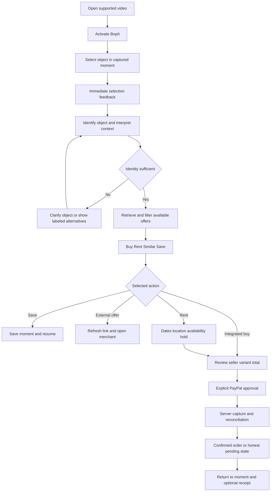

# BopIt Master Implementation Plan

SpatialStream product concept for the PayPal AI Hackathon

**Version:** 1.0

**Primary product:** Google Chrome extension. The website is a compact checkout and demo companion, not a replacement for the extension.

**Planning date:** 25 October 2026

**Repository designated by the team:** https://github.com/VeerabhadraYerram/BopIt

**Deliverable status:** implementation specification; no application has been implemented by creating this document.

**Local state when inspected:** the BopIt directory was empty and was not a Git checkout. The remote contents could not be verified through the available web tools. This plan does not assume existing code, change Git configuration, create commits, or authorize a push.

## How to use this document

This is the single master specification, organized around viewer use cases, what the AI considers, on-screen outputs, and completion or recovery. Supporting technical details are deliberately bounded to a hackathon build. BopIt is the working repository and product name for the SpatialStream concept. The normal interaction begins in a video already open in Google Chrome. The user experience remains the agreed video interaction; a change of repository name does not introduce a different product.

Requirements use three labels. **Required** means necessary for the intended complete hackathon build. **Conditional** means available only with the stated data, provider capability, or platform support. **Later** preserves an expansion idea without claiming it will be demonstrated. Architecture and numerical targets below are proposed implementation decisions, not measured outcomes.

The final two sections contain the detailed browser extension and immediate per-item creator reward specifications. They are required workstreams, placed at the end as requested. Earlier sections reference their acceptance requirements without replacing them.

### Navigation

1. Product contract and competitive position
2. Scope and release boundaries
3. Chrome product surface and access
4. Information architecture
5. Canonical viewer flow
6. Use case inventory
7. Screen and output contracts
8. Detailed viewer use cases
9. Context and personalization decisions
10. Visual design and accessibility
11. Recognition and evidence
12. Discovery and provider data
13. Ranking and comparison
14. Cart and quote behavior
15. Rental operations
16. Payments and recovery
17. Technical architecture
18. Minimal stored data
19. Necessary application operations
20. Security and privacy
21. Build sequence and acceptance gates
22. Testing and evaluation
23. Demo and hackathon release
24. Open decisions and scope controls
25. Sources
26. Google Chrome extension implementation
27. Immediate per-item creator rewards

## 1 Product contract and competitive position

### 1.1 The product promise

**A person watching a supported video in Google Chrome can select an object and discover the most useful available ways to get it, with minimal interruption.** The system understands enough of the scene and the person's stated needs to present buying, renting, similar items, saving, or a genuinely relevant related option. Supported financial actions complete through PayPal with explicit review and approval.

The interaction should feel like touching objects inside the video. A soft outline acknowledges selection, a compact card explains what the system understood, and a few useful actions lead to real offers. A chatbot conversation, lengthy onboarding, and an account are not prerequisites for initial discovery.

Working positioning: **Watch. Bop an object. Find your way to get it.** Copy must not imply universal website coverage, guaranteed exact recognition, or automatic purchasing without approval.

### 1.2 What we are solving

Video inspiration currently leads to an identification and decision task: what is the object, which model is it, is it suitable for me, where is it available, should I buy or rent, and what will the actual commitment cost? BopIt connects that task to the viewing moment. Success includes a suitable rental, a saved item, or learning that an attractive product is incompatible; conversion alone is not the success measure.

### 1.3 Honest differentiation

MINT already describes selecting objects in video through an extension, AI product discovery, bookmarks, and boards. Seamless describes video shopping, preference-based matching, and automatic creator commissions. These are published project descriptions, not independently tested production capabilities. We must not claim that video shopping, browser selection, personalization, or creator commissions were invented here. [R19, R20]

Our competitive hypothesis is a coherent **context-to-action** experience: the same selected object produces meaningfully different, explainable access choices when purpose, budget, region, dates, or owned equipment change. Combine that with completed booking/payment flows and truthful attribution. A different payment processor or nicer cards alone is insufficient differentiation.

The defining demo question is: **Does context help the viewer make a better-informed choice, and can they complete their chosen supported transaction?** Evidence includes useful warnings, alternatives and changed recommendations, not only a personalized greeting. Compatibility advice must not take control away from the shopper.

### 1.4 Reference scenario

A viewer watches a small photography tutorial and adds a camera to the cart. When they select a lens, BopIt compares verified specifications against that camera, politely warns of any direct-mount mismatch and offers alternatives. The original lens remains available to add and buy; it may be for another camera, a gift or an adapter-supported setup. Rental intent and dates can additionally surface available booking options. The viewer reviews their chosen charge and pays in the sandbox. Eligible source attribution drives the separately specified creator reward.

This is the demonstration wedge, not a rule that every user must be a photographer. Ordinary object discovery should also work for permitted clothing, furniture, desk items, and instruments; category-specific suitability claims require stronger data.

## 2 Scope and release boundaries

| Capability | Classification | Completion requirement |
| --- | --- | --- |
| Authorized recorded video player | Required | Select objects in real video, restore timestamp, support keyboard controls |
| Desktop browser extension | Required | One declared browser and supported external video surface pass Section 26 |
| Point selection with drag correction | Required | Bind selection to the exact analyzed frame; manual crop remains available |
| Context interpretation | Required | Scene evidence plus editable user intent affects outputs |
| Buy and Similar discovery | Required | Actual Channel3 retrieval; exact and alternative matches stay distinct |
| Rental discovery and booking | Required | Provider-maintained sandbox inventory, date checks, holds, payment, cancellation |
| Save selected moment | Required | Local saving with refreshed offers; account synchronization is later |
| PayPal checkout | Required | Real sandbox API create/approve/capture flow, not simulated success |
| Per-item attribution and funded reward | Required | Section 27 ledger and real sandbox payout attempt, with truthful item status |
| Smooth cartoony experience | Required | Shared components, responsive states, reduced motion and keyboard paths |
| Public creator/merchant self-service | Later | Enrolled demo participants through controlled configuration suffice initially |
| Lightweight multi-item cart | Required | Camera and lens can coexist; cart items inform advisory compatibility checks |
| Checkout grouping | Required bounded form | Same seller/currency purchase lines may share checkout; rentals and external sellers remain separate actions |
| External merchant purchase | Conditional | Refreshed clickout; do not claim order completion without provider evidence |
| Multiple unrelated sellers in one payment | Later | Requires a verified marketplace integration and operational design |
| Continuous live video context | Later | Recorded flow first; authorized live input only after capability tests |
| Broad site, country and device support | Later | Publish a tested support matrix; unsupported users receive useful fallbacks |
| Voice, avatar, social feed, automatic outfit building | Later | No dependency of the main flow on these features |
| Full automated dispute resolution | Later | Original agreement concept does not expand this build into a dispute platform |

Do not remove the extension or creator payout silently to simplify delivery. If a gate fails, record it as incomplete, explain what works, and show a truthful fallback. Do not substitute mocked provider operations while describing them as live.

## 3 Chrome product surface and access

The Google Chrome extension is the primary product. Someone already watching a supported video activates BopIt, selects what they like, and receives options in a small adjacent card. They should not need to upload that video or move into a shopping dashboard.

The companion website provides a trusted compact checkout, licensed demonstration player and judge playground. It is also a fallback when a video surface or device is unsupported. Desktop Chrome is the first declared browser. Mobile and other browsers may use the responsive sample player; do not describe that as mobile extension support.

Discovery and local saving work as a guest. Region, budget, purpose and owned equipment are optional editable preferences, not a mandatory onboarding form. PayPal payer approval is separate from BopIt sign-in. Start without a broad account system or role-management project.

The demo merchant, rental inventory and enrolled creator can be set up through controlled configuration. Their setup must not interrupt the viewer. A small creator ledger is enough to demonstrate rewards; provider and administrator portals are deferred.

Recommend a declared US/USD sandbox market because Channel3's current documented locale list does not include India/INR. A viewer in India can explore the explicit demo market, but we must not imply local delivery or INR checkout. Market support, payment support and website capture support are separate. [R6]

## 4 Information architecture

Build three coherent surfaces, not a dozen dashboards.

| Surface | What the viewer does | What must remain visible |
| --- | --- | --- |
| Chrome video and BopIt card | Select, clarify, compare, choose Buy/Rent/Similar/Save | Selected moment, identity status, relevant options and close action |
| Compact trusted checkout and receipt | Review exact commitment, approve PayPal, inspect actual result | Same selected item, final total, provider, return to video |
| Judge playground at `/demo` | Try licensed sample, change explicit context presets, inspect reward evidence | Environment labels, instructions and working entry points |

Saved moments can be a simple tray in the card or companion page. Creator reward details can be an adjacent demo panel rather than a public account portal. Orders/bookings need a compact authorized receipt/status view, not an extensive management suite.

The owned sample player can place review and PayPal approval inline beside the video. The extension may open a compact trusted pop-out for checkout where browser security requires it. Preserve the video timestamp and selection; never make the viewer reconstruct the shopping intent after redirecting.

## 5 Canonical viewer flow

### 5.1 First use

The viewer can try a licensed sample immediately. Before selected image evidence leaves the device, explain what is sent and obtain the applicable consent. Offer an optional region choice and a skip path. Do not require budget, owned-equipment inventory, creator follow lists, or a chat transcript before showing a result.

Activation enters an explicit selection mode. Ordinary video clicks retain their original meaning outside this mode. On the controlled player, capture the frame associated with the click. The extension's freeze-then-select strategy is specified in Section 26 to prevent selecting an object from one moment and analyzing a different moment.

### 5.2 Selection and playback

Store whether playback was running, its timestamp, the frame dimensions, and the selected region. Capture intent never rewinds the source or pauses unrelated videos. Preserve a thumbnail while analysis runs. Closing the panel restores the previous playing/paused state only when BopIt changed it and the viewer has not subsequently overridden it.

Selection acknowledgement is local and immediate. The card opens with progress states instead of waiting for all providers. A second selection cancels obsolete UI work; late results for the first selection cannot replace the second card. The previous result remains in session history only if the viewer explicitly saves it or requests history.

### 5.3 Progressive results

First show the selected thumbnail and neutral object label. Then show identification status, a scene interpretation, and available actions. Finally show current offers with source and freshness. A single slow provider must not block unrelated useful results, and incomplete results must be labeled.

Budget, purpose, market, dates, and Exact/Similar chips are editable. A change restarts the relevant search or filter stage and increments the result version. It does not create a new charge or overwrite an accepted checkout.

### 5.4 Decision and completion

The viewer chooses a provider offer, confirms variant and delivery or pickup, and sees a complete server-generated quote. Rental dates and location are requested before a reservable total; an initial Rent card may say “Choose dates for availability.” Payment approval opens only from a deliberate checkout action. A canceled approval returns to the intact quote while the hold remains valid.

Completion means an authoritative payment result plus the correct order or booking outcome. “Approved,” “request accepted,” and “payout created” are not interchangeable with paid, booked, and creator paid. Preserve the source moment and provide a safe return action.

## 6 Use case inventory

Each supported case needs a defined outcome; cases explicitly labeled later are coverage boundaries, not extra build requirements. Test IDs below are traceability IDs for the acceptance checks in Section 22.

### 6.1 Viewing and identification

| ID | User situation | Required output or next step |
| --- | --- | --- |
| V01 | New viewer with no account | Immediate sample/discovery path and optional preferences |
| V02 | Viewer selects one visible item | Correct crop, thumbnail and object card |
| V03 | Small object overlaps another | Choose lens versus body versus whole setup; drag correction |
| V04 | Two similar objects appear together | Preserve selected location and ask which candidate when necessary |
| V05 | Branding is hidden or unreadable | Likely or Similar status; no invented exact SKU |
| V06 | Object moves or is briefly occluded | Controlled-player tracking stays attached or suspends honestly |
| V07 | Video cuts to another scene | Invalidate visual tracking; preserve original selection record |
| V08 | Video is resized, letterboxed or fullscreen | Selection uses transformed content coordinates |
| V09 | Viewer rapidly selects several objects | Latest selection wins; prior response cannot overwrite it |
| V10 | Model identifies a person rather than an item | Ask for a tighter object selection; no identity inference |
| V11 | Selected item has no supported product category | Useful explanation and Save; no fake shopping result |
| V12 | Unsupported source, DRM frame or access failure | Clear support status and authorized fallback |
| V13 | Slow or failed vision request | Preserve selection; retry and Save remain usable |
| V14 | Captions criticize the item | Treat criticism as context, not creator endorsement |
| V15 | Non-English scene | Use supported interpretation or state limitation; preserve original evidence |

### 6.2 Discovery and personalized access

| ID | User situation | Required output or next step |
| --- | --- | --- |
| D01 | Wants the exact item | Confirmed or qualified candidates; exact variants distinguishable |
| D02 | Wants the look at lower cost | Visually similar options and explicit differences |
| D03 | Wants the demonstrated capability | Functional requirements and evidence-backed alternatives |
| D04 | Needs temporary use | Rental path with dates requested at the appropriate point |
| D05 | Budget is lower than all known totals | No false match; broaden constraints, Save, or inspect tradeoffs |
| D06 | Cart or owned equipment has a compatibility mismatch | Explain politely, offer alternatives, keep Add to cart and supported purchase enabled |
| D07 | Compatibility is unknown | Unknown label and request necessary detail; never green-check it |
| D08 | No rental provider serves the area | Hide unavailable bookings; offer Buy/Similar/Save |
| D09 | Rental exists but dates are unknown | Provider and indicative rate clearly marked, without confirmed availability |
| D10 | Rental unavailable on chosen dates | Alternate dates/units/providers; do not retain previous availability claim |
| D11 | Offer price or stock changed | Refresh and disclose change before approval |
| D12 | Item unavailable in user's market | Region-specific no-offer state; explicit market switch |
| D13 | Shipping or tax unknown | Known subtotal and unknown components; no fabricated final total |
| D14 | Related accessory is useful | Explain the relationship; verified compatibility where claimed |
| D15 | No related accessory is needed | Do not add one merely to fill a tab |
| D16 | Saved item is revisited | Restore source moment and refetch live metadata/links |
| D17 | Several providers return the same product | Group canonical model; compare seller offers without hiding condition differences |
| D18 | Affiliate offer is shown | Nearby disclosure; commissions do not silently change organic ranking |

### 6.3 Checkout and aftercare

| ID | User situation | Required output or next step |
| --- | --- | --- |
| C01 | Buys one integrated item | Server quote, PayPal approval/capture, own order receipt |
| C02 | Chooses several items, variants or quantities | Correct distinct cart lines, stock and total within the supported seller/currency group |
| C03 | Mixes sellers or currencies | Separate checkout groups with explicit boundaries |
| C04 | Mixes purchase and rental | Separate action groups in first release; no misleading combined total |
| C05 | Selects external merchant offer | Refreshed clickout; purchase completion remains unverified |
| C06 | Cancels PayPal approval | No paid state; preserve valid quote and source moment |
| C07 | Double-clicks payment | One logical charge and result |
| C08 | Network fails during capture | Checking payment state; reconcile original order before any retry |
| C09 | Quote/hold expires before approval | Obtain fresh quote; explain change; reapproval required |
| C10 | Payment completes but booking finalization fails | Reconciliation/compensation workflow, not a false booking |
| C11 | Partial refund requested | Explain this feature is later; offer supported full refund/help where eligible |
| C12 | Rental canceled | Policy-based refund breakdown and released future inventory when appropriate |
| C13 | Rental already handed over | Provider instructions/help; automated return/incident handling later |
| C14 | Browser closes during checkout | Resume using authorized order link/session and show authoritative state |
| C15 | User cannot use PayPal in the selected context | Explain supported route; no fake payment option |

### 6.4 Lightweight access and saved preferences

| ID | User situation | Required output or next step |
| --- | --- | --- |
| A01 | Guest saves without signing in | Local save with On this device label; sync later |
| A02 | Viewer changes or deletes preferences | Future results change; accepted transactions remain immutable |
| A03 | Viewer requests data deletion | Remove permitted personal/discovery data; separate necessary transaction retention |
| A04 | Configured merchant offer changes | Fresh quotes update; accepted snapshot stays preserved |
| A05 | Demo inventory becomes unavailable | New reservations excluded; paid booking remains an explicit obligation |
| A06 | Source not enrolled for rewards | No recipient/reward invented; enrollment details at document end |
| A07 | Viewer asks for account synchronization | Explain local-only baseline; synchronization later |
| A08 | Judge enters the demo | Clear sandbox labels, setup instructions, resettable nonfinancial fixtures |
| A09 | Receipt shows unresolved payment | Safe status refresh/support; no force-success button |
| A10 | User relies on keyboard or reduced motion | Same task completion without motion or pointer dependence |

Extension-specific E cases and creator-reward R cases are in the final sections. These inventories describe bounded supported cases rather than promise arbitrary site, inventory, or regional access.

## 7 Screen and output contracts

### 7.1 Selected object card

Show the selected thumbnail first. Required fields are object label, identity state, one-sentence context explanation, and the currently available actions. Optional fields are observed brand/model, a creator-confirmed identity badge with provenance, and a reason for clarification. Limit the initial card to three useful offers or actions and one row of editable intent chips; expand on demand.

Use labels with fixed meanings:

- **Model confirmed:** distinguishing evidence or enrolled authoritative mapping supports the model; variant confirmation remains separate.
- **Likely match:** plausible identity, insufficient evidence for confirmation.
- **Similar option:** alternative selected for appearance or function, not the object proven to appear in the video.
- **Need a closer look:** identification cannot responsibly proceed without clarification.

Do not label a model Confirmed merely because an embedding search returned a high similarity score. Never show a fabricated percentage of certainty.

### 7.2 Offer cards

| Output | Required fields | Must remain explicit |
| --- | --- | --- |
| Buy | Provider, model, variant, condition, current price/currency, stock status, checkout route | Shipping/tax known or unknown; exact versus alternative |
| Rent | Provider, model, location, billing unit, date status, charge breakdown when dates set | Rate is not a confirmed total; deposit is not an ordinary fee |
| Similar | Reason for suitability, differences, provider, price and freshness | Visual similarity does not establish functional equivalence |
| Related | Connection to selected item, compatibility evidence, offer details | Optional; never auto-added to cart |
| Save | Source reference, timestamp, thumbnail, identity state | Saved offers are not reserved or price-guaranteed |

Every product-link surface must include the applicable affiliate disclosure nearby. For Channel3 offers use the required disclosure: “We may earn a commission when you buy through links on this page.” [R39]

### 7.3 Quote and confirmation

The review screen names seller, item, chosen variant, quantity, fulfillment, rental dates if any, and an itemized amount. Include known taxes, shipping, rental fees and any supported refundable deposit separately. If the integrated provider cannot supply a final charge, block integrated approval until resolved or use an external merchant handoff.

After payment show one of: Checking payment, Payment completed, Payment declined, Payment canceled, or Needs support. A booking has its own Reserving/Confirmed/Not confirmed status. Creator reward status is separate. The viewer should never need to understand internal queue names or API responses to act.

### 7.4 Empty and error copy

| Condition | Suggested copy | Useful action |
| --- | --- | --- |
| Unclear model | “I found similar items, but can't confirm this model yet.” | Tighten selection; view alternatives |
| No regional offer | “No supported offers for your selected market.” | Save; change market explicitly |
| Rental dates needed | “Choose dates to check availability and total cost.” | Choose dates |
| Rental exhausted | “That item isn't available for those dates.” | Other dates; other options |
| Slow lookup | “Still checking providers. Your selected moment is saved here.” | Keep waiting; Save; retry |
| Price changed | “The provider updated this offer. Review the new total.” | Compare old/new; approve fresh quote |
| Capture uncertain | “We're checking your payment. Please don't pay again yet.” | View status; safe background recovery |
| External handoff | “Continue on the merchant's site. Their final total applies.” | Open merchant |

## 8 Detailed viewer use cases

These are the primary implementation specifications. Each case states the situation, interaction, AI/data considerations, output, and completion condition. The inventory in Section 6 remains a coverage checklist; these journeys define the actual experience.

### U01 First use in Chrome without an account

**Situation:** The viewer notices an object while watching a supported video.

**Flow:** Click BopIt in Chrome; see a short selected-evidence processing explanation; grant or decline permission; select the object on a stable captured moment; inspect the card. Region can be selected or the clearly labeled demo market can be used. No long profile or chatbot conversation precedes useful results.

**Consider:** selected crop, limited surrounding video region, permitted title/captions, optional explicit preferences. Do not scan broad viewing history.

**Show:** selected thumbnail, honest identity label, a short context sentence, and only supported actions. If consent is declined, offer an authorized sample or manual-description path without claiming image analysis occurred.

**Complete when:** a guest reaches useful options, can save locally, and can close the card to resume the original viewing state.

### U02 Buy the particular item shown

**Situation:** The viewer wants the exact camera, jacket, keyboard, lamp or instrument.

**Flow:** Select item; retain Same thing; inspect the model evidence; choose required variant; compare providers; use Buy with PayPal for an integrated offer or View at merchant for an external one.

**Consider:** visible identifiers, catalog evidence, enrolled creator mapping when available, variant and regional availability. A similar image alone does not establish exact identity.

**Show:** confirmed or qualified model and variant status, exact-model offers separately from alternatives, seller, condition and fees. Do not turn an unavailable exact item into a different model under the same label.

**Complete when:** the viewer understands what is confirmed and reaches the correct supported checkout.

### U03 Find a similar look for less

**Situation:** The viewer likes an object's appearance but not its price or brand.

**Flow:** Select; choose Similar; set or change a budget; inspect a few alternatives; expand differences only if useful.

**Consider:** visible color, form and style; selected market; stated size or dimensions when relevant. Do not infer the viewer's body measurements from the video.

**Show:** Similar appearance with differences in brand/material/features. Item price within budget is not the same as final total within budget when shipping or tax is unknown. Keep those distinctions clear.

**Complete when:** constraints change the eligible offers and alternatives are never presented as exact matches. If none qualify, offer Save or explicit constraint changes.

### U04 Rent for a weekend or occasion

**Situation:** The viewer wants temporary access to equipment rather than ownership.

**Flow:** Select Rent; discover supported providers without first filling a form; choose dates and approximate service area; inspect actual availability and full-period cost; review and pay.

**Consider:** provider-maintained inventory, dates, service location, rate basis, included equipment and pickup/return rules. An item visible in a creator's video is not automatically that creator's rental listing.

**Show before dates:** indicative rate and Choose dates to check availability. **Show after dates:** the full interval charge, fees, provider timezone, inclusions, fulfillment and cancellation policy. A per-day teaser rate must not look like a confirmed total.

**Complete when:** successful payment produces a committed booking for real application inventory, not merely a charge receipt.

### U05 Get the same practical result

**Situation:** The viewer likes the soft product-lighting effect in a tutorial and wants a suitable alternative.

**Flow:** Select the light; choose Same result; inspect and optionally correct the inferred purpose; apply budget or rental intent; compare candidate solutions.

**Consider:** what is observed in the scene, supported functional requirements, verified product facts and owned equipment explicitly supplied by the viewer. Skill and environment may contribute to the result; purchasing equipment does not guarantee identical output.

**Show:** why a capability such as diffusion matters, what an alternative provides, and limitations. Required accessories are separate from optional upgrades. A light needing an unpriced stand cannot be described as a complete setup at the light's price alone.

**Complete when:** the interpretation materially changes an option and the reason is factual. This is a differentiation hypothesis, not a worldwide-first claim.

### U06 Receive compatibility advice for cart or owned equipment

**Situation:** A camera is already in the viewer's cart and they are considering a lens with a different mount. The viewer may also have explicitly saved owned equipment.

**Flow:** Select lens; compare it with the relevant camera already in the cart; show a small inline warning beside the active Add to cart button. The viewer may inspect compatible alternatives, change the comparison camera, or add the original lens normally. Do not require a warning-confirmation modal or an extra Add anyway step.

**Consider:** cart contents, explicitly selected owned equipment and bounded verified compatibility facts. Name the camera used for comparison. If several cameras are present, offer an optional comparison selector rather than assume all lenses must fit every camera. Do not infer that adding a camera to the cart means the viewer already owns it.

**Show:** Checked compatible, Direct-mount mismatch, or Compatibility unknown. Example: “A quick heads-up: this lens does not attach directly to the camera in your cart. It may need an adapter.” Use adapter wording only as qualified advice; recommend a specific adapter only when its support and limitations are verified. Keep Add to cart enabled and the selected product available. Do not auto-replace or remove either item.

**Complete when:** adding/removing a camera or changing its variant updates the warning and suggestions, while the viewer can still add the mismatched lens and proceed through otherwise supported checkout. Test a purchase for another camera or as a gift. Unsupported categories get discovery without a fake compatibility badge.

### U07 Find a necessary accessory

**Situation:** A microphone or light requires a cable, stand or mount for the intended use.

**Flow:** Select main item; inspect a Required for this option note; inspect the compatible component; choose or save deliberately. Optional recommendations stay separate.

**Consider:** verified connector/mount requirements, box inclusions and owned accessories. Unknown inclusion remains unknown.

**Show:** included, separately required or optional; compatible component; known cost; effect on the complete solution. Never auto-add an accessory.

**Complete when:** the viewer can distinguish necessary acquisition from upselling and still proceed with a simple primary-item purchase.

### U08 Collect several items from a setup

**Situation:** Several desk or studio items are interesting.

**Flow:** Select and save one, return to the frame, select another, and optionally name the local collection. Open items independently later.

**Consider:** distinct object identity and source moments; camera body versus attached lens ambiguity; each saved interpretation.

**Show:** a useful set of saved items with separate Buy/Rent/Similar actions. External listings, integrated purchases and dated rentals may require separate next steps. Do not promise one atomic mixed-seller payment or sum incomplete prices into a final total.

**Complete when:** the viewer retains useful discoveries without compulsory social boards or accounts. A lightweight cart can contain multiple items; a supported same-seller/currency purchase group can be checked out together. Rentals and external merchant routes remain separate commitments.

### U09 Correct an unclear selection

**Situation:** The object is small, obscured, overlapping or has an unreadable label.

**Flow:** Inspect crop; use Adjust selection or choose Lens / Camera body / Whole setup where appropriate; retry on the same captured moment. Similar and Save remain available.

**Consider:** actual selected region and distinguishing evidence. Do not identify a person or infer who owns an item from appearance.

**Show:** I found similar items, but could not confirm this model. Give bounded progress and a correction action rather than an indefinite spinner.

**Complete when:** correction does not require starting over and a late earlier response cannot overwrite the newly selected item.

### U10 Find something available in the selected market

**Situation:** An item is attractive but local shipping or rental availability is absent or unverified.

**Flow:** Inspect region status; choose local alternatives, Save, or explicitly switch market. An external retailer can be opened with its shipping limitation stated.

**Consider:** catalog locale, merchant shipping, rental service area and payment support separately. Converted currency does not prove local delivery.

**Show:** Available here, Availability needs checking or Not supported here. Never silently use US inventory while implying Indian delivery and an INR charge.

**Complete when:** the user understands whether they can proceed and has a useful nonpurchase action when not.

### U11 Change rental dates

**Situation:** The viewer changes a weekend plan or returns after quote expiry.

**Flow:** Change dates; invalidate the previous availability and total immediately; query again; choose another interval or unit if needed; review the new charge.

**Consider:** actual overlap and provider pickup/return rules. Reject past, reversed and invalid ranges. Store UTC instants and display the provider's named timezone; do not build a global calendar product.

**Show:** Checking dates, Available for these dates or Unavailable. Do not retain an old green badge beside changed dates.

**Complete when:** simultaneous last-unit attempts cannot both confirm and expired checkout receives a fresh availability check.

### U12 Return to a saved discovery

**Situation:** The viewer wants the item later.

**Flow:** Open saved tray; choose item; restore its thumbnail/context; refresh offers; return to the source timestamp when supported.

**Consider:** original selection, timestamp reliability and current provider metadata. Mutable prices, variants, stock and short-lived retailer links need refresh. [R7]

**Show:** original moment with current offers. If source access is gone, explain it while retaining permitted saved item metadata.

**Complete when:** identification is not repeated unnecessarily. Local saves are clearly On this device; clearing storage must not be mistaken for cloud synchronization failure.

### U13 Complete an integrated purchase

**Situation:** The participating sandbox merchant can sell the selected item.

**Flow:** Choose variant and quantity; review exact merchant, fulfillment and final total; approve PayPal; inspect actual result; return to video.

**Consider:** current merchant price/stock, supported region, selected variant and frozen review. AI guesses and unrelated retailer prices cannot set the charge.

**Show:** compact review and approval near the viewing flow. The companion player can keep it inline; the extension may use a compact trusted checkout pop-out. Do not route through a dashboard/cart tour.

**Complete when:** real sandbox capture confirms the correct amount/currency and the receipt retains the selected object. Payer approval is not payment completion. [R4]

### U14 Receive and manage a rental

**Situation:** The viewer paid for a defined interval.

**Flow:** Read booking confirmation, pickup/delivery information, inclusions and return deadline; use eligible Cancel or Get help from the receipt.

**Consider:** completed payment plus committed inventory. If booking finalization fails after payment, show Needs support and the actual compensation/refund state.

**Show:** Booked only after reservation commitment. Provider, timezone, fee and policy remain visible. Deposits, damage adjudication and automatic late charges are deferred.

**Complete when:** booking survives refresh and another viewer cannot reserve the same unit for the same interval. A simple receipt is enough; a provider portal is not required.

### U15 Continue at an external retailer

**Situation:** Discovery returns a retailer that BopIt cannot collect payment for.

**Flow:** Inspect offer; choose View at merchant; refresh destination; open retailer; preserve source moment.

**Consider:** current destination and actual conversion-reporting capability. Product discovery does not establish checkout authority. [R3]

**Show:** Continue on the merchant's site; their final total and terms apply. Record a visit, not a paid order. No BopIt refund or immediate reward is inferred from opening the link.

**Complete when:** the route is useful and clearly different from integrated Buy with PayPal.

### U16 Recover from canceled or uncertain payment

**Situation:** Approval closes, connectivity drops, a button is clicked twice or capture times out.

**Flow:** Preserve item/review; inspect the existing operation; show Canceled, Declined, Checking payment or Paid. Do not start another charge because an HTTP response was lost.

**Consider:** saved provider order/capture references and stable logical operation IDs.

**Show:** cancellation returns to a valid review; uncertainty says We are checking your payment; please do not pay again yet. Offer Refresh status, not another Pay button while outcome is unknown.

**Complete when:** repeated requests cannot duplicate capture. These few safeguards remain even though a financial operations platform is outside scope.

### U17 Cancel or request a supported refund

**Situation:** An eligible demo purchase or rental before pickup needs a full refund.

**Flow:** Open receipt; inspect policy; request the supported refund; confirm amount; see Processing, Refunded or Needs support. External orders go to the retailer's support.

**Consider:** original capture, prior refund status, merchant authority and booking policy. No partial-refund adjudication or automatic liability finding from a photo is required.

**Show:** actual refund status. Submission is not completion. A buyer refund does not mean the creator payout was recovered; Section 27 defines that separate policy. [R10]

**Complete when:** one actual full sandbox refund works, duplicate retries do not refund twice and the original receipt remains readable.

### U18 Interpret criticism and background items

**Situation:** The speaker reports a microphone problem or an item appears without endorsement.

**Flow:** Select; inspect a factual context note; choose Similar or examine the original.

**Consider:** permitted caption evidence near the selected moment. If unavailable, do not invent speech or assume access to a platform transcript.

**Show:** The speaker reports noise from this microphone around this moment, with evidence when available. Do not label the product objectively defective or the creator's appearance an endorsement.

**Complete when:** observation, opinion and verified specification remain distinct while helping the viewer decide.

### U19 Use BopIt without hover or animation

**Situation:** The viewer uses keyboard, screen reader, touch or reduced motion.

**Flow:** Activate by control/shortcut; select from detected objects or adjust a region with keys; navigate chips/offers; review checkout; exit predictably.

**Show:** named controls, focus indicators, useful status announcements and text labels for identity/payment states. Reduced motion removes bounce, not information.

**Complete when:** the core task does not depend on dragging, hover, color or animation.

### U20 Unsupported surface or category

**Situation:** Frame access fails, protected playback is unreadable, browser is unsupported or category intelligence is limited.

**Flow:** Explain capability limit; preserve ordinary viewing; offer authorized sample/player or permitted manual description. An unsupported category can still get qualified discovery/Save without fake compatibility.

**Show:** specific support state, never a guessed product from an unreadable frame. A dark image alone does not prove DRM.

**Complete when:** the viewer can recover and site, device, market and category coverage are not conflated.

## 9 Context and personalization decisions

### 9.1 Separate observations from inference

Maintain four inputs: observed scene evidence, inferred task context, explicit preferences and current cart contents. An observed black cylindrical object is not proof of a specific microphone model. A tutorial suggests a use case but does not prove intended use. A camera selected or added to the cart is explicit comparison context, but a cart item is not automatically owned equipment.

Minimum scene record: timestamp, frame evidence, selected region, object category, observed attributes, permitted surrounding context, candidate purpose, source references, and ambiguity flags. Optional caption evidence should include its source interval and not be treated as a system instruction.

### 9.2 Personalization policy

Explicit session intent overrides a conflicting remembered default. Hard constraints are applied deterministically; the model cannot spend above a user budget or invent availability to improve a narrative. Ask only decision-relevant questions. A rental period is needed for a bookable total; a brand preference is optional. A lens mount matters for a lens; it does not gate buying a notebook.

Use Same thing and Same result as interpretation controls. Same thing ranks confirmed identities and matching variants. Same result extracts supported requirements from the scene and evaluates alternatives. If the demonstrated result depends on skill or environment, explain the limit rather than promise the same outcome from purchasing equipment.

### 9.3 Context must change outputs

Define an evaluation pair using identical video evidence. Session A wants ownership; Session B needs a weekend rental; Session C has a camera in the cart with a different lens mount. Show different recommendations and factual warnings. In Session C the original lens remains addable and purchasable. Include a criticism scene to verify that appearance is not treated as endorsement. Do not generate “perfect for you” language without evidence.

## 10 Visual design and accessibility

### 10.1 Design system

Use a shared token package across player, result cards, extension UI and checkout. Proposed tokens: warm cream background, ink-blue text, mint positive accent, peach selection accent, 16–24 px corner radii for cards, 8 px spacing scale, readable 16 px body text on the primary web view, and consistent compact provider labels. Validate contrast rather than assuming pastel colors are accessible.

Use short spring transitions for selection and card appearance, approximately 150–250 ms as a starting design target. Save can animate a thumbnail into the collection tray. Loading movement must communicate work, not suggest purchase success. Reduced-motion mode replaces spatial movement with a quick fade or immediate state change.

Do not cover the video in persistent boxes or prices. Keep the main result to one object, one short explanation, one chip row and a few offers. Detailed comparisons, raw specifications and provider policies expand on demand. No mandatory chat panel, automatic accessory addition or interrupting mascot.

### 10.2 Interaction details

Selection mode has a visible cursor and Escape exit. Click selects; drag provides manual correction. Pinch/zoom or scroll must not accidentally select products. Use a reversible close action and preserve the current object. Do not hijack native playback shortcuts outside the active mode. Offer keyboard-accessible detected-object candidates or a region selection alternative; every transaction control must have a usable non-pointer path.

Focus moves to the card heading after selection, announces progress without repeated interruptions, and returns to the initiating control on close. Bottom sheets must avoid keyboard traps. Labels distinguish unknown, unavailable and not applicable. Use text/icons in addition to color. Financial totals use stable typography, and currency codes remain visible where symbols are ambiguous.

### 10.3 Responsive behavior

Desktop: card adjacent to the video or in a side panel. Small screen: accessible bottom sheet and a persistent source thumbnail. Preserve access to captions, playback controls and the selected moment. Native fullscreen, browser zoom, page zoom, display scaling and right-to-left text need explicit tests; unsupported combinations receive a predictable exit path rather than a broken overlay.

## 11 Recognition and evidence

### 11.1 Pipeline

1. Bind selection to a permitted immutable frame and normalized coordinates.
2. Obtain a target box or manual crop; point-guided segmentation is optional. Include modest surrounding context, not unrelated screen content.
3. Extract visible attributes and text using a vision-language model; validate its structured output.
4. Generate a bounded candidate search; query the catalog using the image and evidence-supported attributes.
5. Compare category, visible details, identifiers and selected variant evidence.
6. Produce an identity state and clarification requirement.
7. Search available acquisition routes; apply deterministic suitability rules.

Choose the multimodal model during G3 against the evaluation set; record provider, exact version, schema mode, latency and cost. Use one server-side vision-language adapter within the bounded tool loop. Do not expose model credentials to browser or extension code. Segmentation is an optional visual enhancement; manual correction must complete the flow without a GPU service.

### 11.2 Evidence precedence

Provider SKU/GTIN and enrolled creator mappings support product identity; manufacturer specifications support compatibility; current provider inventory supports availability. Visible appearance and model-generated descriptions are weaker evidence. A creator mapping needs source verification and can be disputed. A product catalog title is not automatically a certified manufacturer specification.

For the photography wedge, implement a small verified compatibility table for mount, adapter need, supported mode, power and included accessories. Store provenance and version. Return PASS, FAIL, or UNKNOWN; lack of evidence cannot become PASS. For other categories provide useful discovery without pretending the same compatibility rules apply.

### 11.3 Tracking

In the controlled player, lightweight tracking may retain the selected outline through movement. Reassess on occlusion or scene changes. Track ID and product ID are separate: tracking an image does not prove its SKU. The required external extension path may use a stable snapshot rather than promise full-rate moving-video tracking; this difference must be visible and documented.

### 11.4 Model output rules

Validate JSON against a shared schema. Limit retry/repair attempts to one schema repair before a recoverable failure. Reject invented URLs, unavailable identifiers, invalid coordinates, unsupported categories and tool requests outside allowed discovery functions. A model may propose a catalog query; it cannot authorize a charge, refund, identity confirmation, or creator payout.

## 12 Discovery and provider data

### 12.1 Channel3 adapter

Call Channel3 from the backend. Map image/text queries and locale to the verified API/SDK contract; do not assume illustrative endpoint names in this plan are current vendor paths. Normalize results into BopIt's offer schema while retaining product/offer identifiers and provenance. Channel3's sponsor requirement is meaningful API or MCP use; search and enrichment are central here. [R2, R3]

The public developer page currently labels programmatic checkout Coming soon. Treat third-party offers as discovery and refreshed merchant links unless the team separately verifies and obtains checkout access. Never collect money as though BopIt can fulfill an arbitrary retailer's listing. [R3]

Refresh persisted product metadata and merchant links at display and handoff. Store stable product IDs rather than serving old price, availability and offer URL snapshots as current. Historical transaction evidence is a separate immutable record, not a reusable live offer. [R7]

### 12.2 Participating merchant catalog

Maintain an explicit catalog of offers our merchant is authorized to sell in the sandbox. Link discovered candidates to it using verified identifiers, not fuzzy name similarity alone. Its price and stock are authoritative for our checkout and must be labeled as the participating merchant's offer. Do not reuse an external retailer's price and imply that merchant is the PayPal payee.

### 12.3 Rental inventory

Use a provider-maintained database/API, with sandbox inventory seeded for the demonstration if no live partnership exists. Label seeded inventory Demo inventory. The booking engine and financial calls must still run, but no real reservation or commercial provider relationship is implied. Each available listing maps to a physical unit or explicit capacity pool.

### 12.4 Provider contract and failure

Every adapter reports supported markets, freshness, item evidence, action capability, fulfillment, and whether a conversion callback exists. A provider failure produces a partial result and named availability limitation. Do not silently replace real results with fixtures. Respect rate-limit headers; allow a circuit breaker and per-session request budget.

Current Channel3 default documentation lists 10 requests/s for search, 5/s for lookup, a shared 10,000 daily quota and a Retry-After response on 429. Account and hackathon credits may differ; expose actual configured limits and verify before release. [R38]

### 12.5 Tax, shipping, condition and localization

Distinguish new, used and refurbished offers. Preserve tax-included versus tax-exclusive pricing and rental billing units. A currency conversion for comparison is labeled estimated and never changes the merchant charge currency. Market support, shipment availability and payout eligibility are separate checks. If fees are unknown, compare known costs as incomplete rather than claim a definitive cheapest total.

## 13 Ranking and comparison

### 13.1 Separate transaction eligibility from advisory suitability

Transaction eligibility can depend on valid inventory, supported region, available rental dates, final pricing and payment capability. Compatibility is advisory: a mismatch changes the warning or suggested alternatives, not permission to add or purchase the item. Unknown compatibility stays unknown and does not block checkout. Preserve the original selected product. Only an explicit viewer filter such as Only show direct-fit options may hide mismatches, and that filter must be reversible. Do not silently enable it because a camera is in the cart.

### 13.2 Proposed deterministic score

For remaining offers, rank using identity evidence, task suitability, known total cost, date/fulfillment fit, and explicit preferences. Initial weighting is a tunable proposal; compare against a simple cost-first baseline before adopting numeric weights. Keep sponsored placement separate and labeled. Do not rank by the largest creator commission while presenting the result as best for the viewer.

Buy and Rent are different commitments. A rental for three days must use its full required-period charge, fees and separately shown deposit. Do not compare a daily teaser rate with the full purchase price. Avoid fabricated buy-versus-rent break-even estimates that require unknown future usage, resale value or maintenance costs.

### 13.3 Explanations

Generate explanations from allowed evidence IDs and actual filtering outcomes: “Fits the mount you selected,” “Available Saturday to Monday,” or “Lower purchase price; shipping not yet known.” Do not invent reviews, safety ratings, authenticity, fit, endorsements, or guaranteed results. Changing preferences should produce a deterministic new result version with a short explanation of what changed.

## 14 Collection and quote behavior

Use a lightweight local cart as well as saved moments. A camera and lens can coexist regardless of compatibility advice. Read their confirmed model/variant facts to update contextual warnings whenever cart contents change. Same-seller/currency purchase lines can share one supported checkout; rental bookings, external retailers and other currencies remain separate action groups. A unified atomic mixed-provider checkout is later.

Only the server creates the final quote: merchant, item/variant, quantity, fulfillment, rental interval, currency, disclosed fees, final amount and expiry. Unknown costs cannot become zero. A changed material term requires a fresh review and approval. Never alter the amount behind an already approved payment.

Store the quote as typed JSON on the transaction row rather than separate quote/line tables initially. Use integer minor units. Preserve the accepted item and attribution snapshot even if catalog data changes later. Proposed review lifetime is ten minutes, configurable and visible. Expiry rechecks price and inventory.

## 15 Rental operations

The prototype models a small set of physical units at one declared demo location. Store UTC instants and provider timezone, interval rate, included accessories, cancellation policy and a temporary hold. Invalid/past/reversed dates are rejected. No global scheduling portal, deposit engine or damage-adjudication workflow is required.

Prevent conflicting bookings with one transaction: lock the unit/catalog row, expire eligible ordinary holds, check overlap using `existingStart < requestedEnd AND existingEnd > requestedStart`, and insert a hold. Every writer uses the same lock. Keep a small concurrency test proving two requests for the last unit cannot both win.

Before capture, pin the hold. Ordinary timers must not release it while a payment outcome is uncertain. Completed capture commits the booking. Do not hold a database transaction open across a provider network call. If completed payment cannot be fulfilled, show the exception and a compensation/refund outcome rather than a false booking.

Receipt supports confirmation, eligible pre-pickup cancellation and help. Pickup/return terms are visible; provider maintenance portals, automated late charges and partial rental refunds are deferred.

## 16 Payments and recovery

Use one participating sandbox merchant. The trusted companion page uses a supported PayPal approval flow. The owned demo player can keep it inline; Chrome checkout may use a compact pop-out that preserves the selected moment. External retailer links remain external.

1. Server reloads item/variant, price and inventory, then stores a frozen transaction.
2. Create one PayPal order with a stable operation key and persist its provider ID.
3. Viewer explicitly approves the exact commitment.
4. Recheck/pin any reservation and capture the existing order.
5. Verify amount, currency, merchant and actual capture completion before Paid.
6. Store confirmation and independently attempt the funded eligible creator reward.

Client callback or approval alone is not proof of capture. If a response is lost, show Checking payment and query the existing provider resource before retry. Duplicate requests/events must not create a second charge or reward. Provider idempotency retention is endpoint-specific; store local uniqueness and references instead of assuming a universal retry period. [R4, R11]

Keep one full-refund path for eligible integrated demo captures. Store the logical refund before dispatch, prevent a second refund against the same supported full-refund operation and reconcile uncertain status. Submitted may remain pending. External retailer money cannot be refunded by BopIt. [R10]

Persisted state and one safe status-refresh endpoint are sufficient initially. No worker fleet, outbox leasing system, operator portal or comprehensive partial-refund engine is required. Authentic webhook handling may supplement refresh/reconciliation; it must validate provider evidence rather than trust a browser message. [R12]

## 17 Small implementation architecture

Use one TypeScript Next.js service for the companion UI and API, one Manifest V3 extension with locally bundled React components, and PostgreSQL. Share the card's visual tokens and schemas where useful. Pin exact package/model versions during the initial spike; this plan does not install or scaffold them.

The hot path is: selected video crop plus bounded scene context -> one multimodal request with validated structured output -> actual Channel3 search -> deterministic suitability filtering -> progressive card. Start with in-memory request data. Do not require object storage, queued jobs, point-segmentation GPU service and a worker lease before the first result.

Use a click ripple/spotlight for instant feedback. Manual drag correction is the robust fallback. A segmentation model or preprocessed mask can be added only if it improves the tested experience; preprocessed sample masks must not masquerade as instant arbitrary-video segmentation.

Stream short actual progress/results or poll simply. Include selection and preference revisions so old responses cannot replace the current item. Interrupted discovery may be retried; financial side effects require stored IDs and states. Small status-refresh/retry functions can reconcile them without permanent background infrastructure.

The UI can show observable actions such as Mount mismatch, Checking dates and Preparing PayPal. These are action summaries, not private model reasoning. Multiple agents are not asserted to be an eligibility requirement.

### 17.1 Bounded tool-calling behavior

Recommend one bounded decision loop for cases where intent requires resolving a conflict, not a fleet of agents. After identifying the selection, the agent may choose typed tools to search offers, check bounded compatibility, query rental availability, and assemble alternatives. Straightforward exact-item searches can finish in one pass.

Proposed starting limits are three planner rounds, at most six read-only tool calls, and a measured total timeout. The UI's three action stages need not equal three model calls. On exhaustion, show partial valid options, ask for a missing constraint or offer Save; do not invent a completed plan.

| Tool | What it does | Boundary |
| --- | --- | --- |
| `search_products` | Real Channel3 discovery from evidence-supported attributes and market | Read-only, bounded request budget |
| `check_compatibility` | Return compatible, direct-mount mismatch or unknown with comparison item and evidence | Advisory only; cannot block adding or buying an otherwise supported item |
| `find_rental_options` | Query provider inventory/rates for the stated area/dates | No claim that Channel3 supplies rental calendars |
| `prepare_quote` | Assemble a server-validated review for a selected offer | Server computes amount and eligibility |
| `reserve_selected_rental` | Create one hold for the viewer's explicit Reserve action | Not triggered merely by browsing or changing a chip |

Financial execution stays behind deterministic approval checks. The model cannot choose an arbitrary payee, reward recipient, amount or unapproved capture. The PayPal toolkit can provide function-calling wrappers where useful; it does not supply payer consent or imply that all payment/payout operations are available. Its current README describes authorized-order payment tools and does not list a payout tool. Use a narrow direct Payouts adapter where needed. [R36]

### 17.2 Compact actual action trace

The object card may display three concise stages:

1. Identified item and scene.
2. Checked constraints and alternatives.
3. Prepared the selected quote or reservation.

Use actual results to update labels: “Flagged mount mismatch,” “Checked your dates,” or “Ready for PayPal review.” Compatibility flags never disable Add to cart or silently substitute products. Do not display Locked rental hold before one exists, claim all checks passed when one is unknown, or animate fictitious actions. This is an action trace, not private chain-of-thought disclosure.

### 17.3 Optional demonstrations rather than assumed permissions

An arbitrary live catalog result can support a separate **simulated concierge checkout** only if explicitly labeled: “PayPal sandbox demonstration; BopIt does not place a retailer order or arrange delivery.” The receipt records a simulated catalog transaction and the actual sandbox payment separately. Do not say Fulfilled via BopIt when no fulfillment is performed. Incomplete variant, availability, fees or unsupported amount must still block an authoritative final quote. Keep external merchant links for actual acquisition.

Saved items may later gain a **Watch and prepare** rule: check a target price/date condition, prepare a suitable quote when it matches, and ask the viewer to approve. This is useful autonomy without pretending a spending-cap toggle establishes off-session PayPal authorization. Real unattended charges need a verified saved-payment/merchant-initiated flow and payer agreement; ordinary Orders approval cannot simply be skipped. Mark auto-execution as later and capability-gated, not necessary for an agentic demo. [R37]

### 17.4 APIMatic decision do not adopt for this build

**Decision: do not add APIMatic to the hackathon implementation stack.** Evaluation of its documented offering against BopIt's scoped use cases found no necessary capability it supplies beyond our selected integration approach. Its Context Plugin can assist coding, but it does not provide rental inventory, compatibility facts, video understanding, payment authorization or fulfillment. This is a documentation-based scope assessment, not a claim that an installed benchmark showed no benefit. [R40, R41]

Our payment surface is bounded: create/capture orders, one supported full refund, and creator payout creation/status. Use the official PayPal SDK where it covers the selected operations and a small typed REST adapter for Payouts or other uncovered endpoints. The bounded runtime agent calls guarded BopIt tools; an API-context plugin is not required for those calls. No new client-generation platform is needed for this single merchant integration.

Do not install or configure APIMatic as part of the current build gates. Spend that effort on Chrome interaction, meaningful recommendations, rental-provider access and verified sandbox execution. Its development guidance could be convenient, but a demonstrated project need is absent; sponsor participation alone is not an adoption reason.

Rental integration still requires an actual provider and authorized account/API access. APIMatic does not solve that dependency. Building a narrow adapter for one verified provider is the simpler planned route. A future multi-provider API-generation requirement would be a separate architectural decision, not part of this hackathon scope.

Retain these sources as the evaluation record, but omit APIMatic from implemented-stack and sponsor-use claims. Never add a user-facing stage or feature to justify its presence.

## 18 Minimal stored data

| Record | Contents | Purpose |
| --- | --- | --- |
| SelectionResult | Source/capture reference, target, context/results snapshot | Preserve selected moment and compact handoff |
| CatalogItem | Merchant/rental item, variant/unit, stock and compatibility facts | Ground integrated offers and inventory |
| RentalBooking | Unit, interval, hold expiry/state and transaction reference | Prevent overlap and retain booking |
| OrderTransaction | Typed quote JSON, provider IDs, payment/refund state and retry keys | Correct payment and recovery |
| CreatorProfile | Enrolled source and eligible recipient reference | Establish who may earn a reward |
| CreatorRewardLedger | Unique entitlement, line allocations, funding and payout state | Attribution and duplicate prevention |

Local browser storage holds preferences and saved moments first; cloud synchronization is later. Typed JSON can hold context, offers and quote allocations without 20 more tables. Validate schemas and keep real uniqueness constraints around provider resources and rewards.

Seed demonstration inventory with clear labels and verified compatibility facts. Reset only nonfinancial fixtures. Never delete real sandbox captures/payout references to make a demo appear fresh; use new demo-run IDs. Provider secrets stay on the server and sandbox/production are separated.

## 19 Necessary application operations

Keep the implementation action-oriented: analyze selection; refresh offers; check rental dates; prepare quote; create/capture PayPal order; read transaction status; issue an eligible full refund; initiate/reconcile creator reward; save a permitted thumbnail if needed. These are operations, not a requirement for a separate screen or service per operation.

Every response contains selection/capture identity, active revisions, identity status, relevant context, actual available actions, current offer facts and a useful next action. A rental offer without dates has `availability: DATES_REQUIRED`, an indicative rate, `totalPayable: null` and `checkoutReady: false`. Never display a null total as zero.

Stable errors should map to useful copy: Need a closer look, No regional offer, Choose dates, Offer changed, Checking payment, or Payout pending. Keep raw upstream errors and internal queue terminology out of the viewer flow.

Financial input references server-owned item/quote IDs rather than a client-selected amount/payee. Retry keys bind to the same logical operation; reuse with different parameters is rejected. URLs/resource IDs alone do not authorize access. Section 26 specifies the guest/extension handoff.

## 20 Essential privacy and trust

Send only the approved video-region crop and bounded context. Do not upload the entire browser viewport or broad watch history. Ask before optional context processing; captions/transcripts are not assumed available. Keep raw frame retention short and delete unsaved processing images after the documented limit. Saved moments need product/source/time and a permitted thumbnail, not entire clips.

Keep credentials server-side; restrict image size/type; avoid arbitrary server URL fetching and unrestricted background fetch messages. Treat page text, captions and model output as untrusted evidence, not payment instructions. Validate the sender and resource ownership for sensitive operations.

Offer preference/save deletion and a clear On this device label for local storage. Do not promise cloud sync or complete financial-record deletion when those behaviors are unimplemented. Preserve payment/reward records needed to prevent duplicate money movement. Sandbox labels must be unmistakable.

## 21 Build sequence and acceptance gates

Build the Chrome use case first, not after two weeks of companion-site work. These are dependency gates rather than promises about a particular team size or daily velocity.

| Gate | Build | Passing user-facing proof |
| --- | --- | --- |
| G1 Chrome capture probe | Unpacked MV3 extension; one authorized external video surface; frozen selection preview | Correct moment/crop, no unrelated viewport upload, clear unsupported path |
| G2 Bop interaction | Ripple/spotlight, card, correction, close/resume, keyboard alternative | Guest reaches a useful card without chat or account scaffolding |
| G3 Real identification and offers | In-memory structured model response and actual Channel3 calls | New permitted selections work; exact/likely/similar remain honest |
| G4 Context changes outcome | Intent chips, bounded tools, verified compatibility and explanation | Identical scene produces different suitable results for actual constraints |
| G5 Rental action | Dates, full-period pricing, actual inventory query and hold | Changed dates invalidate old result; simultaneous last-unit attempt has one winner |
| G6 PayPal loop | Compact review, create/approve/capture, receipt and status refresh | Real sandbox result; cancel and retry do not duplicate charges; no particular development plugin required |
| G7 Creator reward | Enrolled source, prefunded per-item entitlement and real payout attempt | Actual creator status and reference; no duplicate reward |
| G8 Recovery and polish | Save, one full refund, empty/error states, accessibility, demo hub | Judge completes the flow without assistance and sees truthful labels |

### 21.1 Work within each gate

Build the visible component against typed development fixtures, then replace the relevant data with the real integration. Fixture-only/offline mode remains explicitly labeled. Do not leave a hidden mock financial route enabled while describing it as real.

Finish one vertical slice before broadening: Chrome selection -> real discovery -> context change -> compact quote -> actual sandbox capture -> actual reward status -> return to video. Add the rental variation and targeted recovery cases to that same slice rather than build unrelated screens.

### 21.2 Definition of done per use case

Each case needs a reproducible starting scenario, expected interpretation, actual data mode, visible success output, meaningful failure output and one acceptance check. It is not done because a screenshot looks right or a mocked response returns success. Keep a simple implementation checklist using the U/V/D/C/E/R IDs.

### 21.3 Local and repository discipline

This planning task creates one master Markdown document only. Later implementation should pin exact packages and model version, provide `.env.example` placeholders, a lockfile and concise run instructions. No push, commit or deployment is performed or authorized here. Sandbox transactions are future implementation checks, not actions taken while writing this plan.

## 22 Testing and evaluation

### 22.1 Small representative scenario set

Use authorized video moments with a camera body and attached lens, two similar-looking products, a light needing an accessory, an uncertain item, a criticized microphone with permitted caption evidence, and one nonphotography item. Annotate the selected region, what can actually be identified, compatibility facts and available demonstration offers.

Add one fresh permitted selection outside the canonical sample. The application must not depend entirely on precomputed demo results. Preprocessed outlines can improve the licensed sample's appearance but must not masquerade as real-time arbitrary-video segmentation.

### 22.2 Required acceptance checks

| Area | Test |
| --- | --- |
| Selection | Correct object under resize, zoom and letterboxing; lens versus body correction |
| Stale responses | Select A then B; A returns late but never replaces B |
| Identity | Qualified labels and variant state; no exact claim from appearance alone |
| Context | Same scene plus budget/purpose/cart contents changes recommendations and explanations; compatibility warning leaves Add to cart and supported checkout enabled |
| Caption evidence | Available warning is represented as reported speech; missing captions never become invented narration |
| Costs | Unknown fees remain unknown; complete rental period is not compared to a daily teaser |
| Rental | Dates required for booking, invalid dates rejected, no overlapping last-unit confirmations |
| Payment | Actual sandbox capture, clear cancellation/decline, no duplicate capture on repeated requests |
| Recovery | Lost capture response leads to status check rather than another payment |
| Reward | Actual funded payout attempt, item-level status, duplicate callback cannot pay twice |
| Refund | One supported full refund reconciles to original capture; no assumed creator clawback |
| Privacy | Network inspection finds no unrelated screenshot, provider secret or broad history upload |
| Accessibility | Keyboard and reduced-motion users complete selection, offer review and checkout initiation |
| Honest modes | Live discovery, demo inventory, cached analysis and simulated concierge transactions are distinguishable |
| Agent tools | Only allowlisted tools; exhausted loop returns partial/clarification rather than fabricated completion |

Automate deterministic compatibility, price calculation, overlap and duplicate-protection tests. Use a headed real-browser smoke test for extension capture, permissions and payment popups. Mocked API tests alone do not prove PayPal works.

### 22.3 Performance and request cost

Target local visual acknowledgement within 100–150 ms and a useful shell promptly. Set an initial first-useful-offer goal around five seconds on a documented reference device/network, then measure median and slow cases. Neither a five-second promise nor a 9–15-second estimate is established before benchmarking.

Measure capture, model, catalog and rendering separately. Keep result lanes useful if one source is slow. Show the real pending stage after several seconds without invented percentages. Bound model rounds, image sizes and catalog query fan-out. Respect provider rate-limit headers; current Channel3 default rate documentation must be checked against the actual account configuration. [R38]

### 22.4 User validation

Ask representative viewers to find a suitable option with ordinary searching and with BopIt. Measure completion, time, corrections, confusion and whether exact-versus-similar is understood. Include people unfamiliar with the demo objects. Report sample size and limitations; do not invent conversion uplift or infer statistical significance from a small exploratory study.

## 23 Demo and hackathon release

### 23.1 Main demonstration story

A viewer watches an authorized photography video in Chrome and selects a lens/light. Changing owned equipment or intent changes the offers. A weekend rental is checked and paid. The booking and eligible reward show real statuses. A final unclear-item case demonstrates correction/Save and returns to the video.

| Time | On screen | What it establishes |
| --- | --- | --- |
| 0–15 seconds | Viewer goal and supported Chrome video | Specific audience and primary product surface |
| 15–40 seconds | Activate, select, inspect real crop and identification | Bop interaction and actual discovery |
| 40–65 seconds | Add/change camera in cart; inspect lens warning and alternatives; original lens remains addable | Context informs choice without taking control away |
| 65–90 seconds | Rent for weekend; select dates and inspect total | Actual provider inventory and useful action |
| 90–120 seconds | Compact quote and PayPal sandbox approval | Correct commitment and actual capture |
| 120–145 seconds | Booking and creator reward state | Separate truthful financial outcomes |
| 145–165 seconds | Uncertain match, correction/Save, resume | Graceful recovery and continuity |

If payout remains pending, show Pending. A separate judge path can prove direct purchase/full refund. Do not try to fit every use case into the main recording. The card's three-stage action trace can make the real constraint resolution legible without narrating internal reasoning.

### 23.2 Judge playground

`/demo` provides licensed sample video, setup/install instructions, declared market, sandbox payer instructions and simple explicit context presets. Let judges change chips manually too; presets cannot be the only functioning personalization. Show supported and unsupported paths without participant assistance.

The creator proof is a small adjacent ledger or receipt detail, not a public social dashboard. A reset creates a new nonfinancial scenario/run while preserving sandbox transaction records. Never present a fake payout batch ID or reset real financial history.

### 23.3 Prize and submission facts

The rules list Best Use of Agentic Commerce as an honorable-mention prize, not a separate published track that mandates a particular SDK, MCP server, agent count, automatic capture, or universal retailer checkout. Eligibility and winning are distinct: meaningful tool-driven decisions are a product recommendation, not a guarantee of a prize. [R1]

Submit a runnable build, public licensed repository and demonstration video under three minutes. The five judging criteria are equally weighted. A project can receive one sponsor prize alongside a grand prize or honorable mention. The listed deadline is 12 November 2026 at noon PST, equivalent to 13 November at 1:30 am in India. Keep the runnable demo available through the judging period described in the rules. [R1]

PayPal is central through approved payment and eligible reward execution. Channel3 supplies product discovery. APIMatic was evaluated and is excluded from this build because no necessary project capability depends on it. Render may host the one-service application if useful. Sponsor claims must reflect actual helpful use; do not add features, plugins or an agent swarm only for appearances. [R2, R34, R40]

## 24 Open decisions and scope controls

### 24.1 Resolve first

- Which authorized external Chrome video surface is supported first; YouTube support is a test result, not an assumption.
- Which exact multimodal version meets the quality/latency/cost target on selected evidence.
- Merchant and creator sandbox access, eligible recipient and working Payouts capability.
- Demo catalog, verified compatibility facts, rental location/timezone/rates and policy.
- Reliable compact checkout and return-to-video behavior in the chosen browser setup.
- Source authorization and creator enrollment evidence.

### 24.2 What we keep simple

No seven-role access system, marketplace provider portal, social feed, broad cloud-sync suite, worker fleet, global rental scheduling engine or partial-refund adjudication. Keep only the small stored states necessary for correct payment/reward outcomes. The main detail belongs in viewer use cases and observable outputs.

Auto-watch and prepare can be a later convenience. Unattended purchases require verified payment authorization and should not be added solely to sound agentic. Optional simulated concierge checkout must use explicit no-fulfillment labels; it must not replace the honest external acquisition route or the working integrated demo inventory.

### 24.3 Release completion checklist

- Chrome activation and stable object selection work on the declared external video page.
- Guest reaches useful options without mandatory chat/account setup.
- Identity, variant and compatibility uncertainty are legible.
- Same thing/result and context chips actually change suitable results.
- Buying and dated rental each complete a real sandbox flow.
- Cancellation, capture uncertainty, duplicate requests and one full refund recover correctly.
- Enrolled per-item reward is funded, idempotent and reported with actual status.
- Saved moments, return-to-video, keyboard use and reduced motion work.
- Live, cached, demo inventory and simulated modes are clearly labeled.
- Setup instructions, public-release requirements and the short recording are ready; publishing/pushing still requires the user's later instruction.

## 25 Sources

Checked on 25 October 2026. Source facts may change; verify schemas, account access and rules before implementation/release. No source establishes that BopIt is globally unique or guaranteed to win.

- **R1 Hackathon rules:** https://paypalaihackathon.devpost.com/rules
- **R2 Channel3 challenge:** https://paypalaihackathon.devpost.com/details/channel3
- **R3 Channel3 developers:** https://trychannel3.com/developers/
- **R4 PayPal Orders:** https://developer.paypal.com/api/orders/v2/
- **R6 Channel3 locale coverage:** https://docs.trychannel3.com/faq/catalog-and-coverage
- **R7 Channel3 caching:** https://docs.trychannel3.com/guides/caching
- **R10 PayPal refunds:** https://developer.paypal.com/api/payments/v2/captures-refund
- **R11 PayPal idempotency:** https://developer.paypal.com/api/rest/reference/idempotency/
- **R12 PayPal webhooks:** https://developer.paypal.com/api/rest/webhooks/rest/
- **R14 PayPal Payouts overview:** https://developer.paypal.com/payouts/use-payouts/overview
- **R15 PayPal payout creation:** https://developer.paypal.com/api/payments.payouts-batch/v1/payouts-post
- **R16 PayPal payout retry protection:** https://developer.paypal.com/api/payouts/customize
- **R17 PayPal payout webhooks:** https://developer.paypal.com/payouts/webhooks/
- **R18 US payout pricing:** https://www.paypal.com/us/business/make-payments/mass-payments
- **R19 MINT:** https://devpost.com/software/green-frame
- **R20 Seamless:** https://devpost.com/software/kindergarten-watch
- **R21 Chrome activeTab:** https://developer.chrome.com/docs/extensions/develop/concepts/activeTab
- **R22 Chrome Tabs API:** https://developer.chrome.com/docs/extensions/reference/api/tabs
- **R23 Chrome worker lifecycle:** https://developer.chrome.com/docs/extensions/develop/concepts/service-workers/lifecycle
- **R24 Chrome messaging:** https://developer.chrome.com/docs/extensions/develop/concepts/messaging
- **R25 Chrome cross-origin requests:** https://developer.chrome.com/docs/extensions/develop/concepts/network-requests
- **R26 Canvas origin restrictions:** https://developer.mozilla.org/en-US/docs/Web/HTML/How_to/CORS_enabled_image
- **R27 Extension remote-code rules:** https://developer.chrome.com/docs/extensions/develop/migrate/remote-hosted-code
- **R28 Chrome Identity:** https://developer.chrome.com/docs/extensions/reference/api/identity
- **R29 Chrome storage:** https://developer.chrome.com/docs/extensions/reference/api/storage
- **R33 Playwright extension testing:** https://playwright.dev/docs/chrome-extensions
- **R34 Render challenge:** https://paypalaihackathon.devpost.com/details/render
- **R36 PayPal Agent Toolkit:** https://github.com/paypal/agent-toolkit
- **R37 PayPal saved payment methods:** https://developer.paypal.com/v5/save-payment-methods/overview
- **R38 Channel3 rate limits:** https://docs.trychannel3.com/faq/rate-limits
- **R39 Channel3 commissions and required disclosure:** https://docs.trychannel3.com/commissions
- **R40 APIMatic hackathon offering:** https://paypalaihackathon.devpost.com/details/apimatic
- **R41 APIMatic PayPal Context Plugin:** https://context.apimatic.io/plugins/paypal/

## 26 Google Chrome extension implementation

### 26.1 Primary experience

The viewer already watches a video in Chrome. Toolbar action or an explicit supported shortcut activates BopIt; the frame becomes a stable selection surface; the viewer selects an item; an adjacent card supplies useful actions. No URL copy or video upload is necessary on this supported path. The sample player remains the fallback, not the primary product.

### 26.2 Minimum reliable capture

Start with Manifest V3 permissions `activeTab`, `scripting` and `storage`, plus the specific backend origin. Add `identity` only if account linking needs it. User-triggered activeTab access is temporary and can be revoked on cross-origin navigation. Do not request all browsing access for convenience. [R21]

Identify the intended visible video, preserve its playing/paused state and timestamp when available, and capture a stable frame before accepting the final target selection. If several videos are plausible, offer a picker. Crop locally to the video region before upload; do not send the browser's full viewport.

Direct canvas capture is an optimization on accessible origin-clean media. Catch cross-origin read failures; extension permissions do not automatically untaint pixels. Use explicitly authorized visible-tab capture where available or show a support limitation. [R26]

Chrome's visible-tab capture applies to the active tab in a window rather than an arbitrary target tab ID and has a two-call-per-second limit. Verify tab/document before and after capture; abort if the viewer switched away. [R22]

Do not build continuous background recording. Caption/title evidence is optional and adapter-specific; no automatic platform transcript or retroactive frame access is assumed. Protected/unreadable content produces a frame-unavailable state. A dark frame alone does not identify the cause, and manual dragging cannot bypass unreadable media.

### 26.3 Coordinates and correction

Use one internal convention: normalized `x, y, width, height` relative to the immutable captured image. Store bitmap dimensions, captured CSS viewport size, visible video region, capture ID/hash and timestamp provenance. Derive scaling from actual bitmap/viewport ratios, not an assumed devicePixelRatio.

Handle letterboxing, cropping and object-fit. Reject clicks outside content. The screenshot's visible crop is not automatically the full media coordinate space. Let the viewer point-select or drag-adjust on the frozen image. Provider-specific box conventions are converted at the adapter boundary.

### 26.4 Compact checkout and safe session handoff

Network calls and temporary session handling run in trusted extension contexts. Validate message sender/schema and expose specific operations rather than a general fetch-any-URL bridge. Keep backend origin access narrow. [R24, R25]

For guest checkout use a short-lived one-time handoff code, matching nonce/state, and a server-established web session. Bind the stored selection/transaction to that session; opaque IDs alone do not grant access. The handoff cannot select an arbitrary amount, seller or reward recipient.

If account linking is later needed, use an established authorization-code flow with PKCE/state through Chrome Identity. A packaged extension cannot keep a client secret. Store scoped short-lived tokens in trusted session storage, not page scripts. Handle account mismatch without exposing another user's selection. [R28, R29]

Open checkout via a deliberate viewer gesture. Run PayPal approval on the trusted app origin; maintain crop/context in the small window. On completion/cancel, preserve the original card and return/focus the video when allowed. If automatic closing or focus is blocked, show a clear Return to video action.

### 26.5 Execution and UI continuity

The MV3 worker is not a long-running inference or payment host. Chrome can stop it; the server owns processing and financial result storage. A reopened card reads the existing result/status. Bundle executable extension code locally rather than fetching remote scripts. [R23, R27]

Every request/result carries capture/selection ID and active preference/selection revision. Abort obsolete requests where possible and ignore stale events regardless. Ordinary playback after capture does not change the meaning of a frozen selection.

### 26.6 Acceptance cases

| ID | Situation | Passing behavior |
| --- | --- | --- |
| E01 | Permission declined/revoked | No silent inspection; useful fallback |
| E02 | Tab changes during capture | No unrelated screenshot upload |
| E03 | Resize, zoom or letterboxing | Correct target/crop and correction |
| E04 | Multiple or inaccessible embedded players | Explicit choice or supported limitation |
| E05 | Unreadable/protected frame | No guessed item or protection workaround |
| E06 | New target while old request runs | Latest selection stays active |
| E07 | Worker/card restarts | Recover stored financial status without duplicate charge |
| E08 | Fullscreen/PiP unsupported | Predictable exit/fallback; restore playback |
| E09 | Checkout popup blocked/canceled | Retry/return without losing intent |
| E10 | Package/network inspection | No provider secrets, remote executable code or unnecessary broad access |

Use documented Playwright extension-capable Chromium testing plus a headed real-Chrome smoke test. Permission, compositor and popup behavior cannot be certified by mocked unit tests alone. [R33]

## 27 Immediate per-item creator rewards

### 27.1 Product goal and recipient

An eligible completed purchase discovered through an enrolled person's content earns an attributable reward automatically. The buyer receipt can show the creator reward state; the demo's small creator ledger shows the same line and payout evidence. This is visible proof of financial action, not a background feature buried from judges.

The interface may call it a creator royalty. The baseline mechanism is a funded referral reward under an explicit agreement, not an inference that recognizing an object establishes rights or recipient identity. A person appearing in a video is not automatically eligible.

Enroll a verified demo creator/source and recipient through controlled setup. Distinguish source ownership, product endorsement and sale/rental inventory. Freeze source, selected object, chosen offer and policy per order line at quote acceptance. The server validates source association; arbitrary client `creatorId` parameters are insufficient.

### 27.2 Funding and immediate timing

Use a prefunded merchant/platform campaign with eligible products, reward rate/amount, budget and fee allowance. Customer capture alone does not guarantee immediately available payout funds.

Channel3 affiliate commissions are a separate revenue stream: its documentation says they settle after the retailer's return window through Stripe, can be adjusted/canceled, and include its commission share. Do not pass unsettled affiliate revenue off as instantly funded PayPal rewards. Display the required affiliate disclosure near those offers. [R39]

Immediate means: verify captured eligible purchase/booking; calculate/store entitlement once; reserve campaign funding; automatically initiate the supported payout promptly. It does not guarantee instantaneous receipt. Verify Payouts access, funding and recipient country support at the start. [R14]

### 27.3 Per-item calculation

Store capture/order line, source, enrolled creator, eligible amount, policy/rate version, reward amount, currency and funding source. Define discount treatment and rounding; exclude tax/shipping unless the agreement includes them. Rental reward applies to the paid booking fee under its own explicit rule.

Enforce uniqueness for capture/line/creator/policy. A supported multi-item checkout can aggregate same-creator payout items while retaining per-line allocations. Do not assign the entire cart to the last viewed source. An external clickout alone is never a verified conversion.

### 27.4 User-visible states

| State | Meaning | UI message |
| --- | --- | --- |
| Not eligible | No valid source/policy/conversion | No reward promised |
| Earned | Completed capture and funded entitlement | Creator reward earned |
| Submitting | Stored logical payout is being dispatched | Sending creator reward |
| Pending | Provider has not confirmed item success | Creator payout pending |
| Paid | Individual payout item confirms success | Creator paid with amount/reference |
| Needs action | Funding, recipient or provider issue | Purchase confirmed; creator payout needs action |
| Returned/adjusted | Later provider result changes payout outcome | Updated ledger state without rewriting history |

Do not label the separate Payouts operation as a native payment split. Buyer payment and creator payout have independent outcomes. Request acceptance or HTTP 201 is not proof the creator received funds.

### 27.5 Small reliable payout loop

Persist one logical payout attempt with stable `sender_batch_id` and request key before sending. Reuse them for uncertain retries. PayPal documents duplicate batch protection for 30 days; `sender_item_id` alone is not application-level duplicate protection. Reconcile a long-unresolved attempt rather than blindly creating another. [R15, R16]

Read actual item status and fetch details when necessary; batch events can lack item details. Pending/unclaimed/held outcomes remain unresolved. A small Refresh status action can reconcile the stored attempt without an always-on worker fleet. [R17]

### 27.6 Refund exposure and fees

For the prototype, choose a disclosed policy that the campaign absorbs a successfully paid creator reward when the buyer receives an eligible refund. Record the relationship. Do not promise automatic clawback from a creator account. Any future offset arrangement needs explicit agreement and supported operations.

Tiny immediate payouts can cost more in fees than the reward. Current US API pricing lists a per-payout fee; actual account/product/jurisdiction matters. Configure fee allowance, aggregate same-order same-creator allocations when applicable and disclose promotional funding. Do not claim established profitability or assume a global percentage fee. [R18]

### 27.7 Acceptance and closing demonstration

| ID | Case | Passing behavior |
| --- | --- | --- |
| R01 | Eligible capture | One entitlement and actual sandbox payout attempt |
| R02 | Duplicate callback/event | No duplicate entitlement or payout |
| R03 | Source unverified/ineligible | No invented recipient |
| R04 | External merchant opened | No completed purchase/reward inferred |
| R05 | Funding/recipient issue | Truthful pending/blocked status; purchase unaffected |
| R06 | Payout request times out | Reconcile original attempt with stable IDs |
| R07 | Buyer refunded after payout | Record campaign exposure; no fake automatic recovery |
| R08 | Batch accepted, item pending | Remain Pending, not Paid |
| R09 | Different eligible lines in cart | Correct allocations, not blanket commission |
| R10 | Demo reset | Preserve actual sandbox references and financial history |

The final demonstration should be easy to understand: the viewer selects something useful inside Chrome, completes the appropriate action, and the enrolled person responsible for the eligible discovery receives a traceable reward with an honest payout status.
